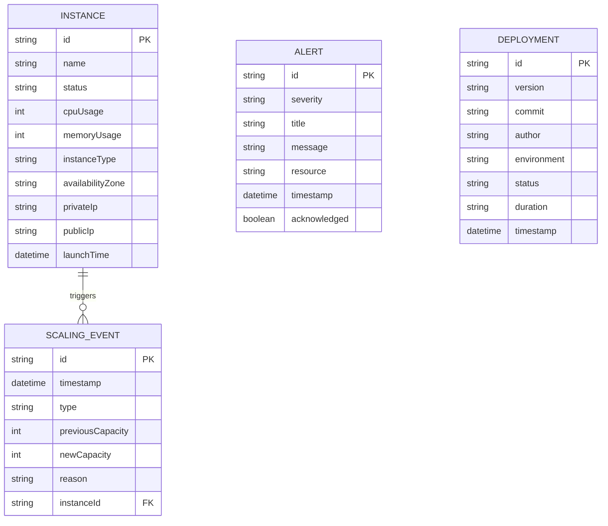

# Software Requirements Specification (SRS)
## CloudScale — Auto-Scaling Cloud Application

**Document Version:** 1.0  
**Date:** 15 October 2026  
**Status:** Baseline Draft for Review  
**Standard:** IEEE 830 / ISO/IEC/IEEE 29148 Compliant  
**Prepared For:** Academic / Hackathon Evaluation  

---

## Document Control

| Field | Value |
| :--- | :--- |
| **Project Name** | CloudScale — Auto-Scaling Cloud Application |
| **Document Title** | Software Requirements Specification (SRS) |
| **Document Version** | 1.0 |
| **Release Date** | 15 October 2026 |
| **Document Status** | Baseline draft; confirm assumptions before implementation |
| **Primary Audience** | Project team, technical reviewers, QA testers, hackathon judges |
| **Target Platform** | Web application deployed on AWS (EC2 ASG, ALB, RDS MySQL) |

### Revision History

| Version | Date | Author / Team | Description |
| :--- | :--- | :--- | :--- |
| **1.0** | 15 October 2026 | CloudScale Core Team | Initial complete SRS covering frontend, backend, AWS deployment, auto scaling, security, CI/CD, monitoring, and acceptance test plans. |

---

## Table of Contents

- [1. Introduction](#1-introduction)
  - [1.1 Purpose](#11-purpose)
  - [1.2 Scope](#12-scope)
  - [1.3 Project Objectives](#13-project-objectives)
  - [1.4 Intended Audience](#14-intended-audience)
  - [1.5 Definitions and Conventions](#15-definitions-and-conventions)
  - [1.6 Out of Scope](#16-out-of-scope)
- [2. Overall Description](#2-overall-description)
  - [2.1 Product Perspective](#21-product-perspective)
  - [2.2 Product Functions](#22-product-functions)
  - [2.3 Operating Environment](#23-operating-environment)
  - [2.4 Design and Implementation Constraints](#24-design-and-implementation-constraints)
- [3. Stakeholders and User Classes](#3-stakeholders-and-user-classes)
  - [3.1 Stakeholder Profiles](#31-stakeholder-profiles)
  - [3.2 User Authentication and Authorization](#32-user-authentication-and-authorization)
- [4. System Architecture and Design Constraints](#4-system-architecture-and-design-constraints)
  - [4.1 Logical Architecture](#41-logical-architecture)
  - [4.2 End-to-End Request Flow](#42-end-to-end-request-flow)
  - [4.3 Network and Security Boundaries](#43-network-and-security-boundaries)
- [5. Functional Requirements](#5-functional-requirements)
  - [5.1 Navigation and Dashboard (FR-001 to FR-007)](#51-navigation-and-dashboard)
  - [5.2 EC2 Instance Management (FR-010 to FR-014)](#52-ec2-instance-management)
  - [5.3 Traffic Testing Simulator (FR-020 to FR-025)](#53-traffic-testing-simulator)
  - [5.4 Scaling Policies and Events (FR-030 to FR-034)](#54-scaling-policies-and-events)
  - [5.5 Monitoring and Alerts (FR-040 to FR-044)](#55-monitoring-and-alerts)
  - [5.6 CI/CD and Deployments (FR-050 to FR-054)](#56-cicd-and-deployments)
  - [5.7 API Rate Limiting (FR-060 to FR-064)](#57-api-rate-limiting)
  - [5.8 Settings and Preferences (FR-070 to FR-073)](#58-settings-and-preferences)
  - [5.9 Backend Health and API (FR-080 to FR-084)](#59-backend-health-and-api)
- [6. External Interface Requirements](#6-external-interface-requirements)
  - [6.1 User Interface Requirements](#61-user-interface-requirements)
  - [6.2 Software Interfaces](#62-software-interfaces)
  - [6.3 Client Browser Storage](#63-client-browser-storage)
  - [6.4 API Error Conventions](#64-api-error-conventions)
- [7. Data Requirements](#7-data-requirements)
  - [7.1 Core Data Entities](#71-core-data-entities)
  - [7.2 Data Integrity and Validation](#72-data-integrity-and-validation)
  - [7.3 Data Retention Policies](#73-data-retention-policies)
- [8. Non-Functional Requirements](#8-non-functional-requirements)
  - [8.1 Performance (NFR-001 to NFR-004)](#81-performance)
  - [8.2 Availability and Resilience (NFR-010 to NFR-013)](#82-availability-and-resilience)
  - [8.3 Scalability (NFR-020 to NFR-023)](#83-scalability)
  - [8.4 Maintainability and Portability (NFR-030 to NFR-033)](#84-maintainability-and-portability)
  - [8.5 Usability and Accessibility (NFR-040 to NFR-043)](#85-usability-and-accessibility)
  - [8.6 Observability (NFR-050 to NFR-052)](#86-observability)
- [9. Security and Privacy Requirements](#9-security-and-privacy-requirements)
  - [9.1 Security Controls (SEC-001 to SEC-012)](#91-security-controls)
  - [9.2 Threat Modeling & Mitigation Matrix](#92-threat-modeling--mitigation-matrix)
- [10. Operational and Deployment Requirements](#10-operational-and-deployment-requirements)
  - [10.1 Local Development Environment](#101-local-development-environment)
  - [10.2 AWS Cloud Deployment](#102-aws-cloud-deployment)
  - [10.3 Deployment & Rollout Strategy](#103-deployment--rollout-strategy)
  - [10.4 Cloud Cost Management](#104-cloud-cost-management)
- [11. Testing and Verification](#11-testing-and-verification)
  - [11.1 Test Levels & Methodology](#111-test-levels--methodology)
  - [11.2 Traceable Test Cases (TC-001 to TC-015)](#112-traceable-test-cases)
  - [11.3 Evidence Collection Guidelines](#113-evidence-collection-guidelines)
- [12. Acceptance Criteria and Demonstration Plan](#12-acceptance-criteria-and-demonstration-plan)
  - [12.1 Mandatory Acceptance Criteria (AC-01 to AC-09)](#121-mandatory-acceptance-criteria)
  - [12.2 Judge Demonstration Sequence](#122-judge-demonstration-sequence)
- [13. Risks, Assumptions, and Dependencies](#13-risks-assumptions-and-dependencies)
  - [13.1 Risk Assessment & Mitigation (R-01 to R-06)](#131-risk-assessment--mitigation)
  - [13.2 Assumptions (A-01 to A-02)](#132-assumptions)
  - [13.3 Technical Dependencies (D-01 to D-02)](#133-technical-dependencies)
  - [13.4 Open Design Decisions](#134-open-design-decisions)
- [14. Future Enhancements](#14-future-enhancements)
- [Appendix A. Proposed API Contract](#appendix-a-proposed-api-contract)
- [Appendix B. Glossary of Terms](#appendix-b-glossary-of-terms)

---

## 1. Introduction

### 1.1 Purpose
This Software Requirements Specification (SRS) defines the functional requirements, quality attributes, external interfaces, data structures, security controls, cloud deployment architecture, and verification plans for **CloudScale**. 

CloudScale is a resilient cloud-native application and observability dashboard engineered to demonstrate:
- Elastic compute scaling driven by CPU utilization via an **EC2 Auto Scaling Group (ASG)**.
- Ingress traffic distribution and dynamic target health checks via an **AWS Application Load Balancer (ALB)**.
- Containerized Java backend services powered by **Spring Boot 3.x**.
- Relational persistence in a multi-AZ **Amazon RDS for MySQL** database isolated within private subnets.
- Automated continuous integration and deployment through **GitHub Actions**.
- Real-time client-side and server-side **API Rate Limiting** with standard RFC 6585 status handling.

### 1.2 Scope
The scope encompasses:
1. **Frontend Dashboard**: A responsive Single Page Application (SPA) built with React 18 and Vite providing infrastructure inspection, traffic generation, policy controls, monitoring alerts, and CI/CD visualization.
2. **Backend REST API**: A stateless Spring Boot REST microservice communicating with relational storage and providing health, metrics, and application endpoints.
3. **AWS Infrastructure**: An isolated Virtual Private Cloud (VPC) featuring public ALBs, private EC2 compute tiers, and isolated database subnets.
4. **CI/CD Pipeline**: GitHub Actions workflows responsible for automated builds, JUnit/Testcontainer suites, Docker image packaging, and deployment rollout.
5. **Simulation Mode**: A high-fidelity client simulation engine enabling complete UI/UX evaluation and demonstration prior to live cloud backend connectivity, explicitly identifying mock telemetry.

### 1.3 Project Objectives
- **Single Pane of Glass**: Provide an enterprise-grade console to monitor application health, request throughput, compute nodes, scaling actions, alerts, and deployment logs.
- **Elastic Compute Under Load**: Demonstrate automated scale-out (+1 or more instances) when cluster CPU crosses 70%, followed by cooldown and scale-in when load subsides.
- **Zero Downtime Ingress**: Demonstrate seamless traffic routing across healthy backend targets with automatic draining of unhealthy or rebooting instances.
- **Network Isolation**: Secure database access strictly to the application security group, denying public internet ingress to persistence layers.
- **Repeatable Verification**: Supply traceable test cases, evidence artifacts, and automated verification scripts for evaluators and judges.

### 1.4 Intended Audience
- **Project Team**: Frontend engineers, backend developers, and DevOps/Cloud architects.
- **Evaluators & Judges**: Academic reviewers, hackathon judges, and infrastructure auditors.
- **Quality Assurance**: Functional and security testers verifying requirements traceability.

### 1.5 Definitions and Conventions
- **Requirement Levels**: The keywords **MUST**, **SHOULD**, and **MAY** in this document follow RFC 2119 / IEEE standards.
- **Requirement Identifiers**:
  - `FR-xxx`: Functional Requirement
  - `NFR-xxx`: Non-Functional Requirement
  - `SEC-xxx`: Security Requirement
  - `TC-xxx`: Verification Test Case
  - `AC-xxx`: Acceptance Criterion

### 1.6 Out of Scope
The following areas are intentionally outside the baseline scope:
1. Multi-account AWS Organizations landing zones.
2. Kubernetes / EKS orchestration (baseline uses EC2 Launch Templates + Docker).
3. Real monetary financial transactions or payment gateway integrations.
4. Formal SLA-backed financial indemnities for zero downtime.
5. Indiscriminate stress-testing or denial-of-service tests against non-CloudScale public infrastructure.

---

## 2. Overall Description

### 2.1 Product Perspective
CloudScale acts as an operational monitoring and management console. The frontend SPA interacts with the backend REST service over HTTPS/JSON. The backend serves application traffic, executes transactions against Amazon RDS MySQL, and interfaces with CloudWatch metrics. AWS Auto Scaling adjusts the EC2 fleet size in response to CloudWatch alarms.

```
+-------------------------------------------------------------------------+
|                              AWS Cloud VPC                              |
|                                                                         |
|  +--------------------+       Public Subnets                            |
|  | User Web Browser   | --------> [ AWS Application Load Balancer ]    |
|  | (React SPA)        |                  |                              |
|  +--------------------+                  | (HTTP :8080 Target Group)    |
|                                          v                              |
|                               Private Application Subnets               |
|                               +-------------------------------+         |
|                               | EC2 Auto Scaling Group        |         |
|                               |  [Spring Boot Instance 01]    |         |
|                               |  [Spring Boot Instance 02]    |         |
|                               |  [Spring Boot Instance ..N]   |         |
|                               +---------------+---------------+         |
|                                               |                         |
|                                               | (TCP :3306 MySQL)       |
|                                               v                         |
|                               Private Database Subnets                  |
|                               +-------------------------------+         |
|                               | Amazon RDS MySQL (Multi-AZ)   |         |
|                               +-------------------------------+         |
+-------------------------------------------------------------------------+
```

### 2.2 Product Functions
- **Fleet Telemetry Overview**: Real-time aggregation of node counts, CPU utilization, requests/min, and availability.
- **Instance Inventory**: Inspection, filtering, and simulated reboot/termination of individual EC2 instances.
- **Traffic Load Generation**: Interactive load simulator with configurable virtual users, durations, and request budgets.
- **Dynamic Policy Tuning**: Runtime editing of Min/Desired/Max capacity bounds and CPU target thresholds.
- **Alarm & Incident Management**: Real-time alerting across CPU, connection pool saturation, and ALB 5xx errors with acknowledgement workflows.
- **CI/CD Visibility**: Real-time 5-stage deployment runner visualization (Checkout &rarr; Build &rarr; Test &rarr; Package &rarr; Deploy).
- **Rate Limit Throttling**: Live Token Bucket visualization and instantaneous request burst simulation triggering HTTP 429.

### 2.3 Operating Environment

| Component | Baseline Technology Stack |
| :--- | :--- |
| **Frontend Framework** | React 18, Vite 5, JavaScript (JSX) |
| **Routing & Navigation** | React Router DOM v6 |
| **Data Visualization** | Recharts (Responsive SVG Area/Line/Bar charts) |
| **Icons & UI Assets** | Lucide React |
| **API Client** | Axios (with configurable timeout & interceptors) |
| **Styling** | Plain Custom CSS Design System (Zero Tailwind/Bootstrap) |
| **Backend Runtime** | Java 17 / 21, Spring Boot 3.x |
| **Backend Modules** | Spring Web, Spring Boot Actuator, Spring Data JPA, HikariCP |
| **Database Tier** | Amazon RDS for MySQL 8.0 (Multi-AZ db.r6g.large) |
| **Compute & Ingress** | AWS EC2 (Amazon Linux 2023), AWS Application Load Balancer (ALB) |
| **Orchestration** | EC2 Auto Scaling Group (Target Tracking Scaling Policy) |
| **Continuous Integration** | GitHub Actions (`.github/workflows/deploy.yml`), AWS ECR |
| **Supported Browsers** | Chromium-based (Chrome, Edge, Brave), Firefox, Safari |

### 2.4 Design and Implementation Constraints
1. **Frontend-First Incremental Delivery**: The frontend must function completely using client-side mock data and simulations before live AWS connection.
2. **Simulated Telemetry Identification**: Every synthetic or mock metric MUST be clearly identified with tags or notices (`Simulated Telemetry`, `Mock Mode`).
3. **Stateless Compute**: Application nodes must maintain zero local session state so that nodes can be launched or terminated without user disruption.
4. **Credential Isolation**: Under no circumstances shall AWS Access Keys, Secret Keys, database passwords, or GitHub Personal Access Tokens be embedded in source code, committed to Git, or stored in browser `localStorage`.
5. **Private Data Tier**: The RDS instance must reside strictly in private database subnets without a public IP address.

---

## 3. Stakeholders and User Classes

### 3.1 Stakeholder Profiles

| User Class | Description & Goals | Permissions & Capabilities |
| :--- | :--- | :--- |
| **Project Administrator** | Oversees infrastructure operations, tunes ASG thresholds, and reviews audit logs. | Full access to dashboard views, configuration forms, and local state management. |
| **Developer / SRE** | Inspects instance health, monitors error rates, triggers deployments, and reviews build logs. | Reads operational telemetry, runs demo load tests, triggers simulated pipelines. |
| **Evaluator / Judge** | Assesses project compliance, verifies auto-scaling behavior, and inspects security configurations. | Read-only evaluation walkthrough, interactive trigger of demonstrations. |
| **Automated System** | Health checkers (ALB), metrics collectors (CloudWatch), and deployment runners (GitHub Actions). | Machine-to-machine authenticated access restricted via IAM roles and security groups. |

### 3.2 User Authentication and Authorization
- **Prototype Mode**: In development and local sandbox demonstrations, access controls are bypassed to streamline testing.
- **Production Mode**: When publicly exposed, administrative actions (editing policies, triggering deployments, starting load generators) MUST be gated behind authenticated sessions (e.g. Spring Security JWT or OAuth2).

---

## 4. System Architecture and Design Constraints

### 4.1 Logical Architecture

| Layer | Technology | Primary Responsibilities |
| :--- | :--- | :--- |
| **Presentation** | React 18 SPA (Vite) | Renders responsive dashboard, interactive charts, forms, modals, and simulation runners. |
| **API Client** | Axios Service Layer | Handles REST calls, request timeouts, error serialization, and mock-to-live fallbacks. |
| **Ingress & Routing** | AWS ALB | Terminates SSL, executes target health checks, and distributes traffic evenly across targets. |
| **Application Tier** | Spring Boot 3.x | Houses domain logic, input validation, HikariCP connection pooling, and Actuator metrics. |
| **Elastic Compute** | AWS EC2 Auto Scaling | Provisions/terminates EC2 instances dynamically based on CPU target tracking algorithms. |
| **Persistence** | Amazon RDS MySQL | Multi-AZ relational storage with automated snapshots and read-replica replication. |
| **Observability** | AWS CloudWatch | Gathers CPUUtilization, TargetResponseTime, and 5xx error metrics; triggers alarms. |
| **CI/CD** | GitHub Actions | Builds code, executes integration tests, packages Docker images, and drives rolling deploys. |

### 4.2 End-to-End Request Flow
1. **User Request**: The client browser issues an HTTPS request to the CloudScale domain.
2. **DNS & Ingress**: Route 53 resolves the domain to the AWS Application Load Balancer.
3. **Target Routing**: The ALB forwards traffic to healthy Spring Boot containers registered on port 8080.
4. **Business Logic & Persistence**: The Spring Boot service processes the query, validating input and executing SQL against the private RDS MySQL instance.
5. **Telemetry Sampling**: CloudWatch continuously samples EC2 CPU utilization at 1-minute intervals.
6. **Auto Scaling Trigger**: If average CPU exceeds 70% over 3 consecutive evaluation periods, the ASG launches replacement/scale-out instances.
7. **CI/CD Automation**: Commits pushed to `main` trigger GitHub Actions to run JUnit test suites, compile container images, push to Amazon ECR, and execute rolling updates.

### 4.3 Network and Security Boundaries
- **Public Ingress**: Only the ALB public subnets permit inbound internet traffic on ports 80 and 443.
- **Application Security Group**: EC2 instances accept TCP port 8080 traffic exclusively from the ALB security group.
- **Database Security Group**: RDS instances accept TCP port 3306 traffic exclusively from the Application security group.
- **Direct Internet Ingress Denied**: No public IPv4 addresses are assigned to internal database instances.

---

## 5. Functional Requirements

### 5.1 Navigation and Dashboard
- **FR-001 [Must]**: The system MUST provide responsive navigation across eight distinct views: *Overview*, *Instances*, *Traffic Testing*, *Scaling Policies*, *Monitoring & Alerts*, *Deployments*, *API Rate Limiting*, and *Settings*.
- **FR-002 [Must]**: The Overview page MUST display four real-time summary KPI cards: Running Instances count, Average CPU Utilization percentage, Requests per Minute (RPM), and Application Availability percentage.
- **FR-003 [Must]**: The Overview page MUST provide responsive Area and Line charts displaying CPU utilization and request throughput across selectable resolutions (`15m`, `1h`, `6h`, `24h`).
- **FR-004 [Must]**: The dashboard MUST display an explicit notice banner identifying whether active metrics are sourced from live AWS telemetry or simulated client streams.
- **FR-005 [Must]**: The header MUST provide an interactive Refresh button with timestamp tracking indicating the last metric synchronization.
- **FR-006 [Must]**: The UI MUST provide explicit Loading, Empty, and Error states for all data-dependent views.
- **FR-007 [Must]**: The header MUST include functional Environment (`Dev`, `Staging`, `Prod`) and AWS Region (`us-east-1`, `us-west-2`, `eu-west-1`, `ap-southeast-1`) selectors that update application context.

### 5.2 EC2 Instance Management
- **FR-010 [Must]**: The Instances page MUST render a tabular inventory showing Instance ID, Name, Health Status, CPU Utilization progress bar, Instance Type, Availability Zone, and Launch Time.
- **FR-011 [Must]**: The instance table MUST provide dynamic keyword search and status filtering (`All`, `Healthy`, `Warning`, `Unhealthy`).
- **FR-012 [Must]**: Clicking an instance row or View button MUST open an accessible modal showing complete metadata (Private IP, Public IP, AMI ID, Target Group, Uptime).
- **FR-013 [Must]**: Simulated instance actions (Reboot, Terminate) MUST only manipulate local client state and clearly state that no live AWS instances are destroyed.
- **FR-014 [Must]**: Terminating a simulated instance MUST trigger an automated replenishment workflow that spawns a replacement instance after a 4-second delay, mimicking Auto Scaling behavior.

### 5.3 Traffic Testing Simulator
- **FR-020 [Must]**: The Traffic Testing page MUST accept Target API selection, Request Budget, Concurrency (virtual users), and Duration parameters with client-side form validation.
- **FR-021 [Must]**: The simulator MUST restrict traffic targets strictly to authorized CloudScale endpoints.
- **FR-022 [Must]**: The simulator MUST display real-time counters for Total Generated Requests, HTTP 200 Successes, HTTP 429 Throttled Requests, and Average Latency.
- **FR-023 [Must]**: The simulation MUST render a live Requests per Second (RPS) AreaChart updated at 1-second intervals.
- **FR-024 [Must]**: The interface MUST provide a Halt button to stop an active test and a Reset button to restore counters.
- **FR-025 [Must]**: When concurrency exceeds 40 virtual users, the simulator MUST generate simulated HTTP 429 responses to demonstrate rate limiting.

### 5.4 Scaling Policies and Events
- **FR-030 [Must]**: The Scaling Policies page MUST display configured Minimum, Desired, and Maximum capacity limits alongside Scale-Out and Scale-In cooldown intervals.
- **FR-031 [Must]**: The page MUST display an interactive visual threshold diagram illustrating the Scale-In (<45%), Equilibrium (45–70%), and Scale-Out (>70%) operating zones.
- **FR-032 [Must]**: The user MUST be able to edit policy parameters in a form that validates boundary constraints ($Min \le Desired \le Max$) and persists changes to local state.
- **FR-033 [Must]**: The system MUST render an audit table of historical scaling events containing timestamps, event types (`SCALE_OUT`, `SCALE_IN`, `HEALTH_CHECK_REPLACE`), capacity deltas, and triggering causes.

### 5.5 Monitoring and Alerts
- **FR-040 [Must]**: The Monitoring page MUST render multi-metric Recharts visualizations for Compute Resources (CPU + JVM Memory) and Ingress Performance (Latency + 5xx Error Rate).
- **FR-041 [Must]**: The page MUST provide an Incident & Alarm management table with severity classifications (`Critical`, `Warning`, `Info`).
- **FR-042 [Must]**: The user MUST be able to filter alerts by severity chip and search by resource identifier.
- **FR-043 [Must]**: The interface MUST support one-click alert acknowledgement and dismissal modifying local state with instant toast notification.

### 5.6 CI/CD and Deployments
- **FR-050 [Must]**: The Deployments page MUST display current release status (Version, Commit SHA, Author, Branch, and Environment).
- **FR-051 [Must]**: The page MUST render an audit table of historical deployments detailing version tags, commit messages, duration, and outcomes (`SUCCESS`, `FAILED`).
- **FR-052 [Must]**: The page MUST provide a "Run Demo Deployment" button that initiates an animated 5-stage pipeline runner:
  1. *Checkout*: Git clone and commit verification.
  2. *Build*: Java 17 / Maven compilation.
  3. *Test*: JUnit 5 & Testcontainers integration tests.
  4. *Package*: Docker container build and Amazon ECR upload.
  5. *Deploy*: Zero-downtime rolling update across ALB target groups.
- **FR-053 [Must]**: The deployment runner MUST display simulated real-time terminal output with an animated cursor.

### 5.7 API Rate Limiting
- **FR-060 [Must]**: The Rate Limiting page MUST track Total Requests, Allowed Requests, Rejected Requests, and HTTP 429 responses.
- **FR-061 [Must]**: The system MUST display an animated Token Bucket capacity visualizer showing remaining available tokens.
- **FR-062 [Must]**: The interface MUST allow users to fire simulated instantaneous bursts of requests to demonstrate token depletion and HTTP 429 responses.
- **FR-063 [Must]**: The page MUST display an endpoint-level usage table illustrating consumed RPM against allocated quota limits.
- **FR-064 [Must]**: The view MUST include an educational architectural panel explaining RFC 6585 standard headers (`Retry-After`, `X-RateLimit-Limit`, `X-RateLimit-Remaining`, `X-RateLimit-Reset`).

### 5.8 Settings and Preferences
- **FR-070 [Must]**: The user MUST be able to configure default AWS Region, metrics time slice, auto-refresh intervals, and notification preferences (Email, Slack, Audio).
- **FR-071 [Must]**: User preferences MUST be persisted in browser `localStorage` across page reloads.
- **FR-072 [Must]**: The page MUST provide a backend API Base URL input (`VITE_API_BASE_URL`) with an interactive "Test Connection" button that gracefully reports connectivity status.
- **FR-073 [Must]**: The page MUST provide a "Reset All Demo Data" button that returns all instances, policies, alerts, and counters back to their initial baseline.

### 5.9 Backend Health and API
- **FR-080 [Must]**: The Spring Boot service MUST expose a standard readiness and liveness health endpoint at `GET /api/health`.
- **FR-081 [Must]**: The API MUST return uniform JSON payloads with consistent error responses.
- **FR-082 [Must]**: All database queries MUST use parameterized JPA/Hibernate bindings to eliminate SQL injection vulnerabilities.
- **FR-083 [Must]**: The service MUST support graceful shutdown, allowing active requests to complete before container termination.

---

## 6. External Interface Requirements

### 6.1 User Interface Requirements
- **Design System**: Professional enterprise SaaS aesthetic utilizing a dark navy sidebar (`#0f172a`), light background (`#f8fafc`), white card surfaces, and accessible status colors.
- **Framework Independence**: Plain CSS design system without third-party CSS utility frameworks (Tailwind, Bootstrap).
- **Responsiveness**: Fully fluid layout supporting desktop (>1200px), tablet (768px–1024px with collapsible sidebar), and mobile (<768px with full-screen navigation drawer).
- **Accessibility**: All interactive elements must maintain visible keyboard focus styles, accessible ARIA labels, and WCAG AA contrast compliance. Status must be denoted by text and icons, not color alone.

### 6.2 Software Interfaces

| Interface | Protocol / Format | Description |
| :--- | :--- | :--- |
| **Frontend to Backend** | HTTPS / JSON REST | Dashboard API communication for metrics, health, instances, and testing. |
| **ALB to EC2 Targets** | HTTP :8080 | Health check probes (`/actuator/health`) and application request forwarding. |
| **Backend to Database** | MySQL Protocol (TCP :3306) | Relational persistence over private VPC subnets. |
| **Backend to CloudWatch**| AWS SDK / HTTPS | Metrics publication (`CPUUtilization`, `RequestCount`, `5xxCount`). |
| **CI/CD to AWS** | HTTPS / GitHub OIDC | Authenticated container publishing to Amazon ECR and launch template updates. |

### 6.3 Client Browser Storage
- Non-sensitive UI preferences (theme, default region, time range, notification toggles) MAY be saved in `localStorage`.
- Secrets, passwords, AWS credentials, and session tokens MUST NEVER be stored in client-side storage.

### 6.4 API Error Conventions

| HTTP Status | Semantic Meaning | Application Context |
| :--- | :--- | :--- |
| **200 OK** | Request succeeded | Normal telemetry and query responses. |
| **201 Created** | Resource created | Successful entity or test creation. |
| **400 Bad Request** | Validation failed | Malformed parameters (e.g. invalid ASG capacity). |
| **401 Unauthorized** | Authentication required | Missing or invalid authentication token. |
| **403 Forbidden** | Authorization denied | Authenticated caller lacks permission. |
| **404 Not Found** | Resource missing | Unknown instance ID or route. |
| **429 Too Many Requests** | Rate limit exceeded | Token Bucket depleted; returns `Retry-After`. |
| **500 Server Error** | Internal fault | Unexpected server-side exception. |

---

## 7. Data Requirements

### 7.1 Core Data Entities



### 7.2 Data Integrity and Validation
- **Unique Identifiers**: Instances (`i-[a-z0-9]{17}`), alerts (`alert-[0-9]{3}`), and deployments (`dep-[0-9]{3}`) must use stable unique keys.
- **Timestamp Format**: All internal timestamps must use ISO-8601 UTC representation (`YYYY-MM-DD HH:mm:ss UTC`).
- **Enumeration Constraints**: Status and severity fields must strictly adhere to allowed enumerations (`healthy`, `warning`, `unhealthy`; `critical`, `warning`, `info`).

### 7.3 Data Retention Policies
- Operational telemetry and time-series data points are sampled and retained across rolling 24-hour windows.
- In-memory simulation events are maintained for the active browser session and can be reset via the Settings console.

---

## 8. Non-Functional Requirements

### 8.1 Performance
- **NFR-001 [Must]**: Dashboard views and route transitions MUST render in less than 100ms under standard browser conditions.
- **NFR-002 [Must]**: Production build output MUST remain under 200 kB gzipped per JavaScript chunk through effective code splitting.
- **NFR-003 [Must]**: The Traffic Testing simulation MUST execute smooth 60 FPS chart updates without UI thread stutter or memory leaks.
- **NFR-004 [Must]**: In future backend deployments, the 95th percentile response time for API health and metadata endpoints MUST not exceed 200ms.

### 8.2 Availability and Resilience
- **NFR-010 [Must]**: The backend service MUST expose an ALB health probe returning 200 OK only when internal components are operational.
- **NFR-011 [Must]**: Unhealthy instances MUST be automatically deregistered by the ALB within 30 seconds of health check failure.
- **NFR-012 [Must]**: The frontend MUST handle backend disconnection gracefully, presenting informative offline fallback states.
- **NFR-013 [Must]**: The application tier MUST remain fully operational across multiple AWS Availability Zones.

### 8.3 Scalability
- **NFR-020 [Must]**: The architecture MUST support linear horizontal scaling from 2 to 10 instances under increased traffic volume.
- **NFR-021 [Must]**: Auto Scaling target tracking policies MUST respond within 3 minutes of sustained CPU threshold violation.
- **NFR-022 [Must]**: Database connection pooling (HikariCP) MUST be capped to prevent exhaustion of MySQL connection limits during scale-out.

### 8.4 Maintainability and Portability
- **NFR-030 [Must]**: Source code MUST maintain clean modular separation across `components/`, `pages/`, `context/`, `services/`, and `utils/`.
- **NFR-031 [Must]**: All external configuration MUST be driven via standard environment variables (`VITE_API_BASE_URL`).
- **NFR-032 [Must]**: Zero proprietary, undocumented libraries or abandoned dependencies shall be utilized.

### 8.5 Usability and Accessibility
- **NFR-040 [Must]**: Navigation and interactive actions MUST be accessible via keyboard (`Tab`, `Enter`, `Escape`).
- **NFR-041 [Must]**: Color schemes MUST satisfy WCAG AA contrast standards (minimum 4.5:1 ratio for normal text).
- **NFR-042 [Must]**: Layouts MUST render cleanly without horizontal scrollbars across screen widths from 320px to 2560px.

### 8.6 Observability
- **NFR-050 [Must]**: All network requests and simulation events MUST produce structured console logging.
- **NFR-051 [Must]**: CloudWatch integration MUST track cluster metrics with clear resolution and units (`%`, `RPM`, `ms`).

---

## 9. Security and Privacy Requirements

### 9.1 Security Controls
- **SEC-001 [Must]**: In live deployments, all public communication MUST be encrypted using TLS 1.3 over HTTPS.
- **SEC-002 [Must]**: Amazon RDS MySQL MUST be provisioned within private subnets with public access strictly disabled.
- **SEC-003 [Must]**: Security group rules MUST adhere to least privilege: EC2 accepts traffic only from ALB; RDS accepts traffic only from EC2.
- **SEC-004 [Must]**: No AWS access keys or secrets shall be stored in frontend files or Git repositories.
- **SEC-005 [Must]**: GitHub Actions deployment workflows MUST authenticate using AWS OIDC Role Federation rather than static long-lived IAM keys.
- **SEC-006 [Must]**: All user inputs in forms and simulation runners MUST undergo strict boundary validation and sanitization.
- **SEC-007 [Must]**: HTTP response headers MUST include standard security protections (CORS origin restrictions, `X-Content-Type-Options: nosniff`).

### 9.2 Threat Modeling & Mitigation Matrix

| Threat Description | Severity | Architecture Mitigation |
| :--- | :--- | :--- |
| **Unauthorized DB Access** | High | Multi-AZ RDS placed in private subnets; ingress restricted to EC2 Security Group on port 3306. |
| **DDoS / Traffic Flooding** | High | AWS ALB absorbs Layer 4/7 spikes; Token Bucket rate limiter returns HTTP 429 when thresholds are breached. |
| **Secret Exfiltration** | Critical | Strict `.gitignore` enforcement; runtime environment variables; zero credentials in client bundle. |
| **Cascading Node Failure** | Medium | Auto Scaling replacement policy launches fresh instances upon target health check failure. |
| **Misleading Telemetry** | Low | Distinct visual pill labels differentiate mock simulations from verified live telemetry. |

---

## 10. Operational and Deployment Requirements

### 10.1 Local Development Environment
Developers must be able to boot the entire frontend stack locally in under 30 seconds:

```bash
# 1. Install dependencies
npm install --legacy-peer-deps

# 2. Run local development server
npm run dev

# 3. Compile optimized production build
npm run build
```

### 10.2 AWS Cloud Deployment
The target deployment pipeline provisions:
1. Custom VPC with two public subnets and four private subnets across two AZs.
2. Internet Gateway and Application Load Balancer in public subnets.
3. Launch Template defining Amazon Linux 2023, Docker, and Spring Boot service.
4. Auto Scaling Group spanning private subnets with Target Tracking at 70% CPU.
5. Multi-AZ Amazon RDS MySQL instance in private DB subnets.
6. CloudWatch Metric Alarms attached to ASG scaling policies.

### 10.3 Deployment & Rollout Strategy
- **Rolling Blue-Green Updates**: During deployment, new instances register with the ALB target group and undergo health validation before old instances are drained and decommissioned.
- **Automated Rollback**: If new instances fail health checks within the grace period (300s), the deployment aborts and maintains existing capacity.

### 10.4 Cloud Cost Management
- Utilize `t3.medium` burstable EC2 instances and `db.t4g.medium` RDS instances for development.
- Configure AWS Budgets with an alert threshold ($20 USD) to avoid unexpected charges.
- Tear down unneeded test resources after demonstrations using automated cleanup scripts.

---

## 11. Testing and Verification

### 11.1 Test Levels & Methodology
Verification spans four tiers:
1. **Unit Testing**: Component isolation testing and formatting utility validation.
2. **Integration Testing**: Context state updates, modal lifecycle, and simulation loops.
3. **End-to-End Simulation Testing**: Complete scenario walkthroughs covering load testing, auto scaling replenishment, and deployment pipelines.
4. **Production Build Verification**: Vite compilation, Rollup code splitting, and bundle size analysis.

### 11.2 Traceable Test Cases

| Test ID | Requirement Trace | Scenario & Test Steps | Expected Outcome |
| :--- | :--- | :--- | :--- |
| **TC-001** | FR-001, FR-006 | Open CloudScale root URL `/`. | Dashboard loads with four KPI cards, CPU area chart, and infrastructure health tiles. |
| **TC-002** | FR-007 | Change AWS Region to `eu-west-1` in Topbar. | Active region updates in state; toast notification fires; telemetry re-samples. |
| **TC-003** | FR-011, FR-012 | In Instances page, search for `i-0d14` and click Details. | Table filters to one row; clicking row opens modal showing full instance properties. |
| **TC-004** | FR-013, FR-014 | Click Terminate on instance `i-0a81`. | Instance is removed from table; after 4 seconds, simulated ASG adds new replacement instance. |
| **TC-005** | FR-020, FR-025 | In Traffic Testing, set concurrency to 50 and click Start. | Simulation runs; live RPS chart plots throughput; HTTP 429 counter records rate-limited calls. |
| **TC-006** | FR-032 | Edit Scaling Policy: change Target CPU from 70% to 65% and save. | Policy saves to state; threshold visualization line shifts to 65%; success toast confirms. |
| **TC-007** | FR-043 | In Monitoring page, click Acknowledge on alert `alert-001`. | Alert state shifts from Active to Acknowledged; counter decreases in bell dropdown. |
| **TC-008** | FR-052 | In Deployments page, click "Run Demo Deployment". | 5 stages execute sequentially with real-time log updates; new release is appended to table. |
| **TC-009** | FR-062 | In Rate Limiting page, click "Fire Burst (Demo)". | Token bucket fill percentage drops; HTTP 429 count increases; success/warning toast fires. |
| **TC-010** | FR-071 | In Settings, toggle Slack Webhook off and click Save. | Value is saved in `localStorage`; persists upon browser reload. |
| **TC-011** | NFR-002 | Execute `npm run build` in terminal. | Vite builds bundle in <10 seconds without errors; chunks are split into vendor, charts, icons. |
| **TC-012** | NFR-040 | Navigate application using exclusively keyboard `Tab` and `Enter`. | All navigation links, buttons, and modal dismiss actions function without a mouse. |
| **TC-013** | NFR-043 | Resize viewport to 375px (mobile screen). | Sidebar collapses into mobile drawer; hamburger button toggles navigation; tables scroll horizontally. |
| **TC-014** | SEC-004 | Inspect client bundle and local storage for credentials. | Zero AWS keys, database passwords, or secret tokens exist in frontend artifacts. |
| **TC-015** | FR-072 | In Settings, click "Test Connection" for backend URL. | Probe triggers and displays graceful offline fallback notice without throwing uncaught exceptions. |

### 11.3 Evidence Collection Guidelines
During final acceptance evaluation, the team shall produce:
1. **Screen Recordings**: Walkthrough of all eight dashboard pages.
2. **Build Logs**: Clean output log of `npm run build`.
3. **Simulated Event Logs**: Exported traces of auto-scaling and rate-limiting demonstrations.
4. **Git Commit History**: Verified commit logs demonstrating adherence to clean branching and security guidelines.

---

## 12. Acceptance Criteria and Demonstration Plan

### 12.1 Mandatory Acceptance Criteria

| Criteria ID | Category | Acceptance Condition | Verification Method |
| :--- | :--- | :--- | :--- |
| **AC-01** | Frontend UI | All eight pages load, navigate smoothly, and prominently label simulated data. | Visual inspection and browser walkthrough. |
| **AC-02** | Responsiveness | Interface operates flawlessly on desktop (1920px), tablet (1024px), and mobile (375px). | Viewport emulation in developer tools. |
| **AC-03** | Instance Management| Users can view, search, filter, and simulate instance actions with automatic ASG replenishment. | Execution of test case TC-004. |
| **AC-04** | Traffic Load Engine | Interactive load testing simulates request spikes and displays real-time RPS and status code charts. | Execution of test case TC-005. |
| **AC-05** | Scaling Engine | Policy adjustments update state; threshold mechanics and scaling event history are clearly displayed. | Execution of test case TC-006. |
| **AC-06** | CI/CD Pipeline | 5-stage deployment pipeline executes with live runner terminal logs and release history tracking. | Execution of test case TC-008. |
| **AC-07** | Rate Limiting | Token Bucket simulation demonstrates token exhaustion and displays standard RFC 6585 headers. | Execution of test case TC-009. |
| **AC-08** | Production Build | `npm run build` completes with optimized code splitting and zero build warnings or errors. | Execution of test case TC-011. |
| **AC-09** | Security & Docs | Comprehensive documentation, architecture diagrams, and zero committed credentials. | Repository audit and this SRS document. |

### 12.2 Judge Demonstration Sequence
1. **Introduction & System Health (2 mins)**:
   - Present Overview dashboard; review running instances (5/5), average CPU (61%), and healthy infrastructure tiles.
   - Highlight the "Simulated Telemetry" notice and demonstrate region/environment switching.
2. **Compute Fleet & Auto Scaling Replenishment (2 mins)**:
   - Navigate to Instances; search and inspect instance `i-0a81` in the detail modal.
   - Click "Terminate" — show instance removal followed by simulated ASG automated replacement after 4 seconds.
3. **Traffic Load Testing & Throttling (3 mins)**:
   - Open Traffic Testing; set 1,000 requests with 50 concurrency against `/api/v1/orders/checkout`.
   - Click "Start Load Simulation"; observe real-time RPS chart climbing and HTTP 429 status code bar activating.
4. **CI/CD Pipeline Simulation (2 mins)**:
   - Open Deployments; click "Run Demo Deployment".
   - Watch the animated 5 stages (Checkout &rarr; Build &rarr; Test &rarr; Package &rarr; Deploy) and review live terminal logs.
5. **Rate Limiting & Token Bucket Mechanics (2 mins)**:
   - Open Rate Limiting; trigger an instantaneous burst of 150 requests.
   - Show token bucket depletion and review standard RFC 6585 response headers (`Retry-After: 30`).
6. **Code Quality & Production Build (1 min)**:
   - Run `npm run build` in the terminal to verify clean, sub-second compilation.

---

## 13. Risks, Assumptions, and Dependencies

### 13.1 Risk Assessment & Mitigation

| Risk ID | Risk Description | Severity | Probability | Mitigation Strategy |
| :--- | :--- | :--- | :--- | :--- |
| **R-01** | AWS cloud cost overruns during stress tests. | High | Medium | Implement AWS Budgets ($20 cap), enforce small instance sizes (`t3.medium`), schedule automatic resource shutdown. |
| **R-02** | Scaling lag during sudden traffic spikes. | Medium | High | Configure predictive scaling rules, maintain 2 warm standby instances, explain cooldown mechanics during evaluation. |
| **R-03** | Database connection pool exhaustion. | High | Low | Cap HikariCP maximum pool size to 50 connections per instance; monitor active RDS connections. |
| **R-04** | Telemetry ambiguity (mock vs live confusion). | Medium | Low | Prominent visual badges and banners explicitly mark all simulated telemetry. |
| **R-05** | Browser storage limits or data loss. | Low | Low | Store only lightweight preference flags; provide a "Reset All Demo Data" button. |
| **R-06** | Build size degradation over time. | Medium | Low | Rollup manual chunking isolates heavy dependencies (`recharts`, `vendor`) into separate cached bundles. |

### 13.2 Assumptions
- **A-01**: Evaluators and users possess an internet connection and a modern browser supporting ES6 and SVG rendering.
- **A-02**: Future AWS deployments will take place in an AWS account with adequate EC2 and VPC service quotas.

### 13.3 Technical Dependencies
- **D-01**: Node.js v18.0.0+ and npm v9.0.0+ runtime environments for local development.
- **D-02**: GitHub Actions hosted runners for continuous integration workflows.

### 13.4 Open Design Decisions
1. *Static Hosting*: Whether to host the frontend via an AWS S3 + CloudFront CDN distribution or containerized behind the ALB.
2. *Rate Limiting Engine*: Selection between Bucket4j in Spring Boot vs. Redis Token Bucket in Spring Cloud Gateway.

---

## 14. Future Enhancements
- **Multi-Region Active-Active Routing**: Route 53 latency-based routing across `us-east-1` and `eu-west-1`.
- **Infrastructure as Code (IaC)**: Complete Terraform and AWS CDK deployment scripts for one-click environment provisioning.
- **Distributed Tracing**: AWS X-Ray and OpenTelemetry integration across Spring Boot microservices.
- **AI-Powered Predictive Scaling**: Machine learning models predicting traffic surges based on historical patterns.

---

## Appendix A. Proposed API Contract

The following REST endpoints represent the formal interface contract between the React frontend and future Spring Boot backend:

| Method | Path | Purpose | Query / Body Parameters | Response Format |
| :--- | :--- | :--- | :--- | :--- |
| `GET` | `/api/health` | Service readiness probe | None | JSON status object |
| `GET` | `/api/infrastructure` | Component operational health | None | Array of infrastructure components |
| `GET` | `/api/instances` | Active EC2 instance list | `?status={healthy\|warning}` | Array of instance objects |
| `POST` | `/api/instances/{id}/reboot` | Signal EC2 instance reboot | None | Action confirmation |
| `DELETE` | `/api/instances/{id}` | Terminate EC2 instance | None | Action confirmation |
| `GET` | `/api/metrics` | CloudWatch time-series data | `?range={15m\|1h\|6h\|24h}` | Time-series data points array |
| `GET` | `/api/scaling/policy` | Retrieve active ASG policy | None | ASG policy configuration |
| `PUT` | `/api/scaling/policy` | Update ASG thresholds | JSON ASG policy payload | Updated policy object |
| `GET` | `/api/scaling/events` | Audit log of scaling events | `?limit=10` | Array of scaling event objects |
| `GET` | `/api/alerts` | Active CloudWatch alarms | `?severity={critical\|warning}`| Array of alert objects |
| `PUT` | `/api/alerts/{id}/ack` | Acknowledge active alarm | None | Updated alert object |
| `GET` | `/api/deployments` | CI/CD release history | None | Array of deployment records |
| `POST` | `/api/deployments/run` | Trigger workflow dispatch | None | Pipeline run descriptor |
| `GET` | `/api/rate-limiting/stats` | Token Bucket usage metrics | None | Rate limit telemetry object |

### A.1 Example Health Check Response (`GET /api/health`)
```json
{
  "status": "UP",
  "timestamp": "2026-10-15T08:30:00Z",
  "service": "cloudscale-core-service",
  "version": "v2.4.1",
  "database": "UP",
  "loadBalancer": "HEALTHY",
  "isMock": false
}
```

### A.2 Example Telemetry Response (`GET /api/metrics?range=1h`)
```json
{
  "source": "AWS/CloudWatch",
  "region": "us-east-1",
  "range": "1h",
  "targetGroup": "tg-cloudscale-api",
  "points": [
    {
      "time": "08:00",
      "cpu": 64,
      "memory": 62,
      "requests": 3420,
      "latency": 24,
      "errorRate": 0.05,
      "dbConnections": 412
    }
  ]
}
```

---

## Appendix B. Glossary of Terms

| Term | Full Name & Definition |
| :--- | :--- |
| **ALB** | **Application Load Balancer**: AWS Layer 7 load balancer routing HTTP/HTTPS traffic to targets. |
| **ASG** | **Auto Scaling Group**: EC2 management service maintaining desired instance capacity. |
| **AMI** | **Amazon Machine Image**: Pre-configured operating system template used to launch EC2 instances. |
| **CI/CD** | **Continuous Integration / Continuous Delivery**: Automated pipeline for building, testing, and deploying software. |
| **CloudWatch** | AWS native monitoring, metrics aggregation, and alarm service. |
| **ECR** | **Elastic Container Registry**: Secure AWS Docker container image repository. |
| **HikariCP** | High-performance JDBC connection pool library utilized by Spring Boot. |
| **HTTP 429** | **Too Many Requests**: Standard RFC 6585 status code returned when rate limit quotas are exceeded. |
| **JVM** | **Java Virtual Machine**: Execution environment for Spring Boot backend microservices. |
| **Multi-AZ** | **Multiple Availability Zones**: Redundant deployment across independent physical data centers. |
| **RDS** | **Relational Database Service**: Managed AWS relational database hosting MySQL. |
| **SPA** | **Single Page Application**: Web application architecture where routing is handled on the client. |
| **Target Tracking** | Scaling policy where EC2 capacity dynamically adjusts to maintain a target metric (e.g. 70% CPU). |
| **VPC** | **Virtual Private Cloud**: Logically isolated software-defined private cloud network in AWS. |

---

**[ END OF SPECIFICATION — CLOUDSCALE SRS V1.0 ]**
